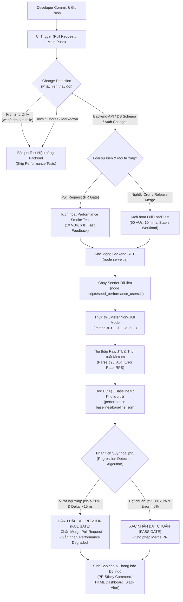

# ĐỀ XUẤT KIẾN TRÚC PIPELINE KIỂM THỬ HIỆU NĂNG LIÊN TỤC
## Continuous Performance Testing Pipeline Proposal | Hệ thống EShop
## Mã sinh viên: 23120268 | File Tài liệu: `docs/performance/CONTINUOUS_PERFORMANCE_TESTING.md`

---

## 1. Tuyên bố Hiện trạng & Định hướng Kiến trúc (Architectural Status Declaration)

> [!IMPORTANT]
> **Phân biệt Rạch ròi giữa Thành phần Đã Triển khai (Implemented) và Kiến trúc Đề xuất (Proposed):**
> * **Thành phần ĐÃ TRIỂN KHAI SẴN SÀNG (Implemented Components):**
>   1. Bộ kịch bản kiểm thử chuẩn hóa Apache JMeter 5.6.3: Load Test ([`23120268_Load_20261118.jmx`](file:///home/hung/26-27/Kiem_thu/eshop-sut/23120268_Load_20261118.jmx)), Stress Test ([`23120268_Stress_20261118.jmx`](file:///home/hung/26-27/Kiem_thu/eshop-sut/23120268_Stress_20261118.jmx)), Spike Test ([`23120268_Spike_20261118.jmx`](file:///home/hung/26-27/Kiem_thu/eshop-sut/23120268_Spike_20261118.jmx)).
>   2. Bộ dữ liệu kiểm thử CSV độc lập: [`data/users.csv`](file:///home/hung/26-27/Kiem_thu/eshop-sut/data/users.csv) (502 users), [`data/products.csv`](file:///home/hung/26-27/Kiem_thu/eshop-sut/data/products.csv) (5 products), [`data/checkout_data.csv`](file:///home/hung/26-27/Kiem_thu/eshop-sut/data/checkout_data.csv).
>   3. Script đồng bộ và seed dữ liệu tự động: [`scripts/seed_performance_users.js`](file:///home/hung/26-27/Kiem_thu/eshop-sut/scripts/seed_performance_users.js).
>   4. Script reset khóa tài khoản khẩn cấp: [`scripts/reset_account_lockout.js`](file:///home/hung/26-27/Kiem_thu/eshop-sut/scripts/reset_account_lockout.js).
>   5. Bộ dữ liệu chuẩn cơ sở (Verified Baseline Metrics) từ lần chạy thực nghiệm Load Test 50 VUs (17,738 samples, 0% error, p95 = 17.0ms).
> * **KIẾN TRÚC ĐỀ XUẤT (Proposed Architecture):**
>   Toàn bộ quy trình tự động hóa CI/CD, cơ chế lắng nghe Git Webhook, bộ lọc phát hiện thay đổi (Change Detection), giải thuật so sánh phát hiện suy thoái hiệu năng ($p95$ Regression Detection) và hệ thống cảnh báo (Alerting) được trình bày trong tài liệu này là **bản đề xuất kỹ thuật (Engineering Proposal)** để đội ngũ kỹ sư tích hợp vào hệ thống CI/CD (GitHub Actions / Jenkins) trong các sprint tiếp theo.

---

## 2. Lưu đồ Quy trình CI/CD Pipeline (Mermaid Flowchart)

Dưới đây là sơ đồ luồng hoạt động tự động hóa toàn diện từ khi lập trình viên đẩy mã nguồn (Git Push) đến khi báo cáo hiệu năng và quyết định Quality Gate:



---

## 3. Điều kiện Kích hoạt Thông minh (Smart Trigger Conditions & Change Detection)

Để tránh lãng phí tài nguyên máy chủ CI/CD và không làm kéo dài thời gian phản hồi cho lập trình viên (Developer Feedback Loop), hệ thống áp dụng cơ chế **Lọc đường dẫn thay đổi (Path-based Change Detection)** thông qua `git diff --name-only`:

| Nhóm Mã nguồn Thay đổi | Đường dẫn Tệp (File Paths Pattern) | Mức độ Ưu tiên | Hành động CI/CD Đề xuất | Lý do Kỹ thuật |
| :--- | :--- | :---: | :---: | :--- |
| **Backend API Core** | `backend/server.js`<br>`backend/routes/**`<br>`backend/controllers/**` | **CRITICAL** | **Bắt buộc chạy Performance Test** | Chứa logic xử lý của 9 endpoints trong workflow; nguy cơ gây nghẽn Event Loop. |
| **Database & Schema** | `backend/database.js`<br>`backend/migrations/**`<br>`backend/models/**` | **CRITICAL** | **Bắt buộc chạy + Reset Seeder** | Thay đổi câu truy vấn, chỉ mục Index hoặc khóa bảng SQLite ảnh hưởng trực tiếp tới độ trễ I/O đĩa. |
| **Authentication Logic**| Logic JWT, đăng nhập, cơ chế khóa tài khoản `login_attempts` | **HIGH** | **Chạy Auth & Load Test** | Nguy cơ khóa tài khoản diện rộng hoặc rò rỉ token làm tê liệt toàn bộ luồng E2E. |
| **Cart & Session Store**| Biến bộ nhớ `userCarts`, giỏ hàng `/api/cart` | **HIGH** | **Chạy Load & Memory Check** | Quản lý bộ nhớ in-memory có thể gây rò rỉ RAM (Memory Leak) hoặc tranh chấp luồng. |
| **Checkout & Orders** | `/api/checkout`, xử lý coupon, insert `orders` | **CRITICAL** | **Bắt buộc chạy Full Test** | Là điểm nghẽn độ trễ lớn nhất hệ thống; rủi ro tranh chấp ghi SQLite `SQLITE_BUSY`. |
| **Frontend Admin / Web** | `frontend-admin/**`<br>`frontend-web/**`<br>`frontend-mobile/**` | **LOW** | **BỎ QUA (Skip)** | Mã nguồn giao diện máy khách, hoàn toàn độc lập với hiệu năng backend API. |
| **Tài liệu & Markdown** | `docs/**`<br>`*.md`<br>`README.md` | **NONE** | **BỎ QUA (Skip)** | Thay đổi tài liệu không ảnh hưởng tới mã thực thi. |

---

## 4. Cơ chế Phát hiện Suy thoái Hiệu năng (p95 Regression Detection Mechanism)

### 4.1 Tại sao chọn $p95$ thay vì Thời gian Phản hồi Trung bình (Average)?
* **Điểm yếu của Average:** Giá trị trung bình thường che giấu các đột biến độ trễ (Latency Spikes) và không phản ánh đúng trải nghiệm của người dùng chịu ảnh hưởng nặng nhất.
* **Sức mạnh của $p95$:** Phân vị 95% đại diện cho giới hạn trên của 95% người dùng thông thường, cực kỳ nhạy cảm với hiện tượng tranh chấp khóa ghi SQLite hoặc nghẽn hàng đợi I/O mà không bị nhiễu bởi các giá trị ngoại lai cực đoan (Outliers) như phân vị $p99.9$ hay $Max$.

### 4.2 Thuật toán Phát hiện Suy thoái Kép (Two-Tier Threshold Strategy)
Để **triệt tiêu hoàn toàn cảnh báo giả (False Positives)** khi chạy trên môi trường CI/CD có độ nhiễu tài nguyên (Shared Cloud Runners), quy tắc kiểm định bắt buộc phải thỏa mãn đồng thời cả **ngưỡng tương đối (Relative)** và **ngưỡng tuyệt đối (Absolute)**:

$$\text{Phát hiện Regression} \iff \left( \frac{p95_{\text{new}} - p95_{\text{baseline}}}{p95_{\text{baseline}}} \ge \mathbf{20\%} \right) \;\land\; \left( p95_{\text{new}} - p95_{\text{baseline}} \ge \mathbf{15\text{ ms}} \right)$$

```
                    [Thuật toán Kiểm định Regression p95]
                                     |
                       Tính delta = p95_new - p95_baseline
                                     |
                       +-------------+-------------+
                       |                           |
                 delta < 15 ms               delta >= 15 ms
                       |                           |
               [BIẾN ĐỘNG NHIỄU]           Tính % tăng = (delta / baseline) * 100
             (Bỏ qua, Đánh giá PASS)               |
                                           +-------+-------+
                                           |               |
                                      % tăng < 20%     % tăng >= 20%
                                           |               |
                                      [CHẤP NHẬN]   [REGRESSION CẢNH BÁO]
                                        (PASS)             (FAIL GATE)
```

#### Bảng Tiêu chí Đánh giá Chất lượng (Quality Gates SLA):

| Tiêu chí Kiểm định (Gate Metric) | Ngưỡng Cho phép (Pass SLA) | Ngưỡng Cảnh báo (Warning) | Ngưỡng Chặn Build (Fail Gate) |
| :--- | :---: | :---: | :---: |
| **Độ trễ $p95$ từng Transaction** | $\Delta \le +15\%$ hoặc $\Delta \le 10\text{ms}$ | $+15\% < \Delta \le +20\%$ | **$\Delta > +20\%$ và $\Delta > 15\text{ms}$** |
| **Độ trễ $p95$ Tổng thể Workflow**| $\le 25\text{ ms}$ | $25\text{ ms} < p95 \le 50\text{ ms}$| **$> 50\text{ ms}$** |
| **Tỷ lệ Lỗi (Error Rate)** | **$0.0\%$** | $0.0\% < \text{Err} \le 0.5\%$ | **$> 1.0\%$** |
| **Thông lượng Giao dịch (TPS)** | $\ge 90\%\text{ baseline}$ | $80\% \le \text{TPS} < 90\%$ | **$< 80\%\text{ baseline}$ (Suy giảm $> 20\%$)** |
| **Quy tắc Xác nhận 2 Lần Chạy** | Không áp dụng | Đánh dấu "Cần kiểm tra lại" | Kích hoạt re-run; nếu 2 lần liên tiếp đều vượt ngưỡng $\rightarrow$ Khẳng định Regression |

---

## 5. Đề xuất Triển khai Kỹ thuật trên GitHub Actions

### 5.1 Cấu trúc Pipeline File (`.github/workflows/performance-test.yml`)
Dưới đây là mã cấu hình hoàn chỉnh đề xuất cho GitHub Actions:

```yaml
name: Continuous Performance Testing Pipeline

on:
  pull_request:
    branches: [ main, develop ]
    paths:
      - 'backend/**'
      - 'scripts/**'
      - 'data/**'
  schedule:
    # Chạy Nightly Test lúc 02:00 UTC hàng ngày
    - cron: '0 2 * * *'
  workflow_dispatch:

jobs:
  performance-gate:
    runs-on: ubuntu-latest
    timeout-minutes: 25

    steps:
      - name: 1. Checkout Source Code
        uses: actions/checkout@v4
        with:
          fetch-depth: 0

      - name: 2. Setup Node.js Runtime
        uses: actions/setup-node@v4
        with:
          node-version: 22

      - name: 3. Setup Java JDK for JMeter
        uses: actions/setup-java@v4
        with:
          distribution: 'temurin'
          java-version: '17'

      - name: 4. Install Apache JMeter 5.6.3
        run: |
          wget https://archive.apache.org/dist/jmeter/binaries/apache-jmeter-5.6.3.tgz -q
          tar -xzf apache-jmeter-5.6.3.tgz
          echo "$GITHUB_WORKSPACE/apache-jmeter-5.6.3/bin" >> $GITHUB_PATH

      - name: 5. Install Backend Dependencies & Start SUT
        run: |
          cd backend
          npm ci
          node server.js &
          echo "SERVER_PID=$!" >> $GITHUB_ENV
          sleep 3

      - name: 6. Seed Performance Test Accounts
        run: |
          node scripts/seed_performance_users.js

      - name: 7. Execute JMeter Load Test (Non-GUI Mode)
        run: |
          mkdir -p build/reports
          jmeter -n \
            -t 23120268_Load_20261118.jmx \
            -l build/load_test_results.jtl \
            -e -o build/reports/html_dashboard \
            -Jthreads=50 \
            -Jrampup=60 \
            -Jduration=300

      - name: 8. Parse Metrics & Regression Detection
        id: perf_eval
        run: |
          python3 scripts/evaluate_performance_regression.py \
            --current build/load_test_results.jtl \
            --baseline docs/performance/baselines/load_baseline.json \
            --output build/perf_summary.md

      - name: 9. Comment Results to Pull Request
        if: github.event_name == 'pull_request'
        uses: marocchino/sticky-pull-request-comment@v2
        with:
          path: build/perf_summary.md

      - name: 10. Archive Performance Artifacts
        if: always()
        uses: actions/upload-artifact@v4
        with:
          name: jmeter-performance-artifacts
          path: |
            build/load_test_results.jtl
            build/reports/html_dashboard
            build/perf_summary.md
```

### 5.2 Quản lý và Lưu trữ Baseline (Baseline Storage Strategy)
* **Vị trí lưu trữ:** Lưu trữ tệp [`docs/performance/baselines/load_baseline.json`](file:///home/hung/26-27/Kiem_thu/eshop-sut/docs/performance/baselines/load_baseline.json) trực tiếp trong nhánh `main` của kho chứa Git.
* **Quy trình Cập nhật Baseline (Baseline Update Lifecycle):**
  * Baseline **không được tự động cập nhật** sau mỗi lần chạy test để tránh hiện tượng "luộc ếch" (Frog Boiling Effect - hiệu năng suy thoái dần dần qua từng commit nhỏ mà không bị phát hiện).
  * Baseline chỉ được cập nhật có chủ đích khi:
    1. Đội ngũ kỹ thuật thực hiện một đợt tái cấu trúc tối ưu hóa lớn (như chuyển sang SQLite WAL, thêm index).
    2. Kỹ sư trưởng (Lead QA / Tech Lead) phê duyệt commit cập nhật baseline kèm bằng chứng thực nghiệm rõ ràng.

---

## 6. Phân tích Đánh đổi Kỹ thuật (Engineering Trade-offs Analysis)

Khi tích hợp kiểm thử hiệu năng vào chu trình CI/CD, đội ngũ phát triển phải đối mặt với các bài toán đánh đổi cốt lõi sau:

| Bài toán Đánh đổi (Trade-off Aspect) | Thách thức Thực tế (The Challenge) | Tác động Tiêu cực (Negative Impact) | Giải pháp Kiến trúc Tối ưu (Optimal Mitigation) |
| :--- | :--- | :--- | :--- |
| **Chi phí Thực thi (Execution Cost)** | Máy chủ CI tính tiền theo phút chạy (GitHub Actions runner minutes). | Chạy bài test 50 VUs trong 10 phút sau mỗi commit sẽ làm cạn kiệt ngân sách CI rất nhanh. | **Mô hình Phân tầng:** Chạy Smoke Test (60s) cho Pull Request; chỉ chạy Full Load Test (10 min) vào ban đêm (Nightly Cron) hoặc trước khi phát hành Release. |
| **Thời gian CI (CI Duration)** | Lập trình viên mong muốn nhận phản hồi trong vòng 3–5 phút sau khi tạo PR. | Bài test hiệu năng dài làm nghẽn hàng đợi CI, cản trở tiến độ merge mã nguồn. | Cắt giảm thời gian ngâm tải trên PR xuống 60–90 giây, chỉ kiểm tra tính ổn định ban đầu và bắt lỗi nghiêm trọng. |
| **Độ tin cậy Runner (Noisy Neighbors)** | Máy chủ ảo hóa đám mây (Shared Runners) dùng chung CPU vật lý với các tác vụ khác. | CPU bị tranh chấp ngẫu nhiên khiến độ trễ dao động mạnh, dễ gây báo động giả (False Alarms). | 1) Sử dụng Self-hosted Runner chuyên dụng cho Performance Test.<br>2) Áp dụng ngưỡng tuyệt đối ($\Delta > 15\text{ms}$) để triệt tiêu nhiễu phần cứng. |
| **Toàn vẹn Dữ liệu (Data Management)** | Thao tác ghi đơn hàng làm tích lũy hàng nghìn dòng vào SQLite; backend khởi động lại sẽ xóa bảng `users`. | Test chạy sau có thể bị chậm do database bị phình to, hoặc bị lỗi 401 nếu thiếu tài khoản. | Pipeline **bắt buộc chạy script `seed_performance_users.js`** sau khi bật server để đảm bảo dữ liệu luôn ở trạng thái sạch và đồng nhất 100%. |

---

## 7. Lộ trình Triển khai 4 Giai đoạn (Phased Implementation Roadmap)

Quá trình chuyển đổi từ kiểm thử thủ công sang tự động hóa hoàn toàn được chia thành 4 giai đoạn tiến hóa:

```
        LỘ TRÌNH 4 GIAI ĐOẠN TRIỂN KHAI PIPELINE
        ════════════════════════════════════════
        
  [Phase 1] ───► [Phase 2] ───► [Phase 3] ───► [Phase 4]
  Basic Smoke    Scheduled      Regression     Automated Gate
  (PR Level)     Nightly Load   Detection      (Block Merge)
   - 10 VUs       - 50 VUs       - Diff vs      - Hard Fail
   - 60s          - 10 mins        Baseline     - Zero Flaky
   - Sanity       - Trends       - Alerts       - Production
```

### Giai đoạn 1: Basic Performance Smoke Test (Kiểm thử Nhanh mức PR)
* **Mục tiêu:** Phát hiện sớm các lỗi nghiêm trọng (crash server, lỗi 500, lỗi 401 do sai dữ liệu) ngay trên từng Pull Request.
* **Cấu hình:** 5 – 10 VUs, Ramp-up 10 giây, Duration 60 giây.
* **Thời gian hoàn thành:** $< 2\text{ phút}$.
* **Hành vi Gate:** Không chặn build về độ trễ, chỉ cảnh báo nếu có lỗi chức năng (`Error Rate > 0%`).

### Giai đoạn 2: Scheduled Nightly Load Test (Kiểm thử Định kỳ Ban đêm)
* **Mục tiêu:** Đo lường hiệu năng chuyên sâu và theo dõi xu hướng biến thiên dài hạn mà không ảnh hưởng tới tiến độ làm việc ban ngày của lập trình viên.
* **Cấu hình:** Sử dụng nguyên bản file [`23120268_Load_20261118.jmx`](file:///home/hung/26-27/Kiem_thu/eshop-sut/23120268_Load_20261118.jmx) (50 VUs, Ramp-up 60s, Duration 600s / 10 phút).
* **Thời gian thực thi:** Chạy tự động lúc 02:00 sáng hàng ngày qua GitHub Actions Cron.
* **Đầu ra:** Tự động sinh HTML Dashboard và lưu trữ lịch sử nhật ký.

### Giai đoạn 3: Regression Detection Engine (Cơ chế Tự động Phát hiện Suy thoái)
* **Mục tiêu:** Tự động hóa việc phân tích tệp JTL, đối chiếu với `baseline.json` và đưa ra kết luận định lượng.
* **Cơ chế:** Kích hoạt thuật toán Two-Tier Threshold ($p95 \ge 20\%$ và $\Delta \ge 15\text{ms}$).
* **Thông báo:** Tự động viết nhận xét trực tiếp vào PR (PR Sticky Comment) dạng bảng so sánh màu sắc (Xanh / Đỏ) và gửi cảnh báo tới kênh Slack/Discord của đội ngũ phát triển.

### Giai đoạn 4: Automated Performance Quality Gate (Cổng Chất lượng Tự động Bắt buộc)
* **Mục tiêu:** Chuyển đổi kiểm thử hiệu năng thành tiêu chuẩn nghiệm thu bắt buộc (Hard Quality Gate).
* **Hành vi Gate:** Nếu PR làm suy thoái $p95$ vượt ngưỡng cho phép:
  1. Trạng thái GitHub Check Run được đánh dấu `FAILURE` (màu đỏ).
  2. Nút **Merge Pull Request bị khóa hoàn toàn** (Protected Branch Rule).
  3. Lập trình viên bắt buộc phải tối ưu hóa mã nguồn hoặc giải trình lý do trước khi được xem xét ngoại lệ.

---

## 8. Danh mục Thành phần Kỹ thuật & Bằng chứng Sẵn sàng (Implementation Readiness)

Hệ thống EShop hiện tại đã hoàn thiện toàn bộ các thành phần kỹ thuật nền tảng để đưa vào Pipeline ngay lập tức:

| Thành phần Pipeline | Tệp Mã nguồn & Tài liệu Thực tế | Trạng thái Sẵn sàng |
| :--- | :--- | :---: |
| **Kịch bản Load Test** | [`23120268_Load_20261118.jmx`](file:///home/hung/26-27/Kiem_thu/eshop-sut/23120268_Load_20261118.jmx) | **SẴN SÀNG (Production-ready)** |
| **Kịch bản Stress Test** | [`23120268_Stress_20261118.jmx`](file:///home/hung/26-27/Kiem_thu/eshop-sut/23120268_Stress_20261118.jmx) | **SẴN SÀNG (Production-ready)** |
| **Kịch bản Spike Test** | [`23120268_Spike_20261118.jmx`](file:///home/hung/26-27/Kiem_thu/eshop-sut/23120268_Spike_20261118.jmx) | **SẴN SÀNG (Production-ready)** |
| **Dữ liệu Người dùng Test** | [`data/users.csv`](file:///home/hung/26-27/Kiem_thu/eshop-sut/data/users.csv) (502 accounts chuẩn) | **SẴN SÀNG (Đã kiểm chứng)** |
| **Script Nạp Dữ liệu Tự động**| [`scripts/seed_performance_users.js`](file:///home/hung/26-27/Kiem_thu/eshop-sut/scripts/seed_performance_users.js) (Async/await, API self-check) | **SẴN SÀNG (Đã kiểm chứng)** |
| **Script Mở khóa Tài khoản** | [`scripts/reset_account_lockout.js`](file:///home/hung/26-27/Kiem_thu/eshop-sut/scripts/reset_account_lockout.js) | **SẴN SÀNG (Đã kiểm chứng)** |
| **Dữ liệu Baseline Thực nghiệm**| Phân tích chi tiết tại [`AI_PERFORMANCE_ANALYSIS.md`](file:///home/hung/26-27/Kiem_thu/eshop-sut/docs/performance/AI_PERFORMANCE_ANALYSIS.md) | **SẴN SÀNG (Đã kiểm chứng)** |
| **CI/CD Workflow Config** | Mẫu cấu hình GitHub Actions hoàn chỉnh tại Mục 5 | **ĐỀ XUẤT (Chờ cấu hình CI)** |
